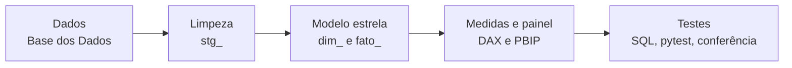
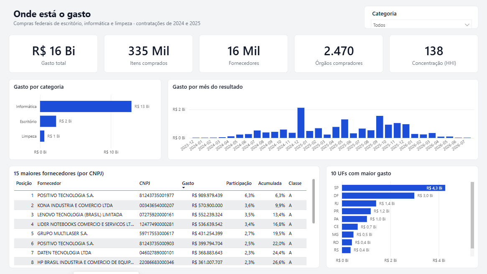
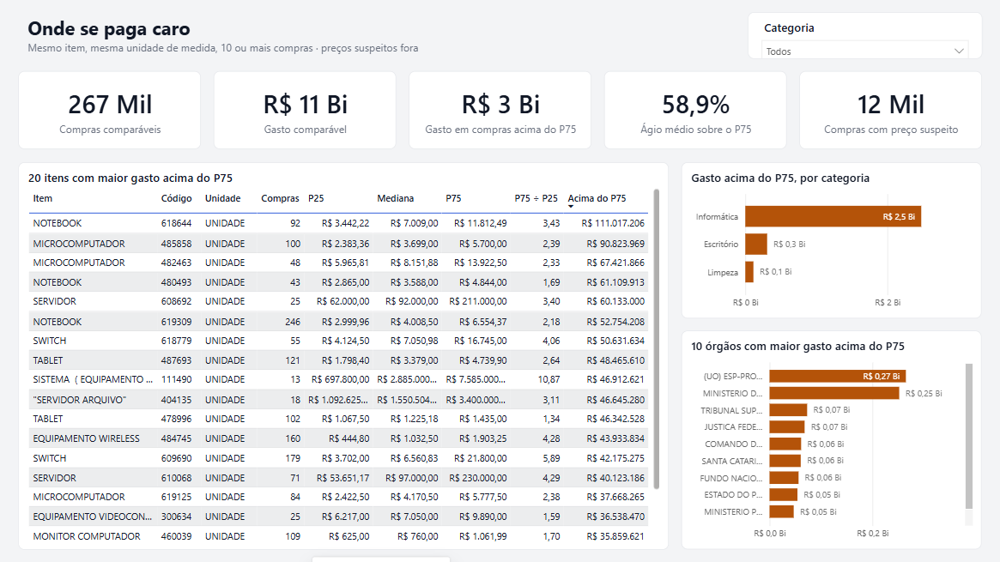
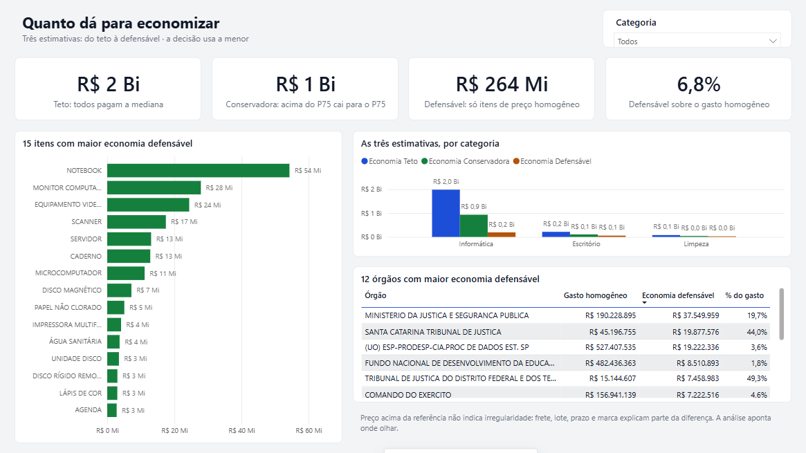
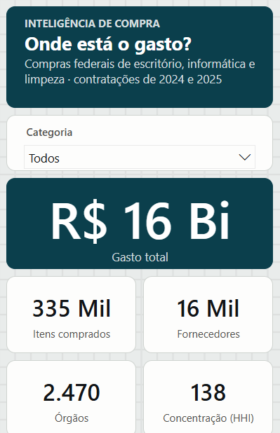
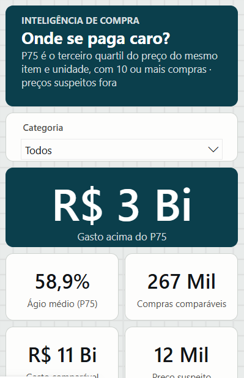
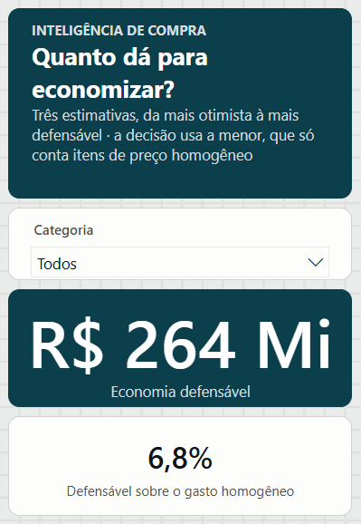

# Inteligência de Compra

[](https://github.com/diaquinodev/inteligencia-de-compra/actions/workflows/dados.yml)
[](https://github.com/diaquinodev/inteligencia-de-compra/actions/workflows/ci.yml)

O mesmo item sai por preços bem diferentes, conforme a unidade, o comprador e o fornecedor.
Este repositório entrega um painel de Power BI (gasto, preço, economia) sobre compras públicas
de escritório, informática e limpeza, no papel de histórico de um ERP.
O diferencial: o painel é gerado por código e os dados passam por testes e validações.
O fluxo se repete; se uma regra falha ou um número sai da referência, a execução acusa. Isso o deixa reproduzível e confiável para uma empresa.

> **Sobre os dados.** São compras públicas federais de 2024 e 2025, publicadas pela
> [Base dos Dados](https://basedosdados.org/dataset/bb11d3e6-6bac-412e-bbb8-773369771a70).
> Aqui elas fazem o papel do histórico de compras de um ERP. Os números não descrevem
> nenhuma empresa privada. Os valores da análise e o que eles não permitem concluir estão
> em [docs/analises.md](docs/analises.md).

## Como o painel é gerado por código

Nada do relatório é montado à mão no Power BI Desktop. Um comando lê três fontes em texto
e regrava o projeto.

| Fonte | O que define |
|---|---|
| [powerbi/medidas.dax](powerbi/medidas.dax) | 30 medidas DAX e as consultas de conferência |
| [src/compras/painel/paginas.py](src/compras/painel/paginas.py) | as 3 páginas: visuais, campos, posição, no computador e no celular |
| [src/compras/painel/tema.py](src/compras/painel/tema.py) | 5 temas (compras, financeiro, vendas, pessoas, operações) |

`python -m compras painel` ([src/compras/painel/projeto.py](src/compras/painel/projeto.py))
apaga o relatório e escreve de novo o PBIP, o tema, as páginas e a tabela `Medidas`.
Gerar duas vezes produz o mesmo arquivo e remove visual que não está mais no código
([tests/test_painel.py](tests/test_painel.py)).

O modelo estrela que o painel lê não sai desse comando. As tabelas nascem no BigQuery, um
arquivo SQL por tabela (`CREATE OR REPLACE`, então rodar de novo chega ao mesmo
resultado). O TMDL do modelo (tabelas, colunas e relacionamentos) fica versionado em
[powerbi/inteligencia-de-compra.SemanticModel](powerbi/inteligencia-de-compra.SemanticModel);
o gerador só exige que ele exista e preenche a tabela de medidas.



| Etapa | Onde | O que acontece |
|---|---|---|
| Dados | [sql/10_raw_catalogo.sql](sql/10_raw_catalogo.sql) a [sql/13_raw_fornecedor.sql](sql/13_raw_fornecedor.sql) | recorte da origem, sem transformar |
| Limpeza | [sql/20_stg_fornecedor_documento.sql](sql/20_stg_fornecedor_documento.sql) a [sql/23_stg_contratacao.sql](sql/23_stg_contratacao.sql) | tipos, duplicata, motivo de exclusão, referência de preço |
| Modelo estrela | [sql/30_dim_item.sql](sql/30_dim_item.sql) a [sql/33_dim_tempo.sql](sql/33_dim_tempo.sql) e [sql/40_fato_item_compra.sql](sql/40_fato_item_compra.sql) | fato de item comprado e quatro dimensões: item, fornecedor, órgão, tempo. O desenho está em [docs/modelo.md](docs/modelo.md) |
| Análises | [sql/50_mart_gasto_fornecedor.sql](sql/50_mart_gasto_fornecedor.sql) a [sql/53_mart_resumo_categoria.sql](sql/53_mart_resumo_categoria.sql) | respostas prontas das três perguntas |
| Funil | [sql/60_qualidade_resumo.sql](sql/60_qualidade_resumo.sql) | quantas linhas e quanto valor cada regra de limpeza tirou ([docs/qualidade.md](docs/qualidade.md)) |
| Medidas e painel | `medidas.dax`, `paginas.py`, `tema.py` | `python -m compras painel` |
| Testes | [sql/tests/](sql/tests/), [tests/](tests/) | abaixo |

São 18 arquivos em [sql/](sql/) (um por tabela). O executor
([src/compras/executor.py](src/compras/executor.py)) roda em ordem de nome, estima o custo
antes e recusa a consulta que passaria do teto de bytes.

TODO (Diego): o tempo para recriar as tabelas e para gerar o painel não está medido neste
repositório. Se quiser citar um número, meça e substitua esta linha.

O passo a passo de abrir, conferir e fotografar o painel (isso sim exige Windows e Power
BI Desktop) está em [powerbi/README.md](powerbi/README.md). As decisões de layout estão em
[powerbi/DESIGN.md](powerbi/DESIGN.md).

## O painel

As imagens abaixo já estão no repositório (`docs/img/`). Cada página também tem layout de
celular, gerado pelo mesmo código.







<p>
  
  
  
</p>

## Testes e validações

Há duas camadas. As regras de dados rodam no BigQuery. Os testes de Python não precisam
de banco: conferem o gerador, o executor e a comparação com a referência.

### Regras de dados (13 consultas)

Cada arquivo de [sql/tests/](sql/tests/) é uma consulta que tem de voltar vazia. Qualquer
linha é violação. O nome do arquivo é o nome da regra
([src/compras/qualidade.py](src/compras/qualidade.py)). O detalhe e o funil estão em
[docs/qualidade.md](docs/qualidade.md).

| Regra | O que confere |
|---|---|
| [fato_chave_unica](sql/tests/fato_chave_unica.sql) | cada item de contratação aparece uma vez |
| [fato_dimensoes_presentes](sql/tests/fato_dimensoes_presentes.sql) | toda linha da fato encontra item, fornecedor, órgão e data |
| [fato_valores_positivos](sql/tests/fato_valores_positivos.sql) | quantidade, preço e total maiores que zero |
| [fato_total_igual_preco_vezes_quantidade](sql/tests/fato_total_igual_preco_vezes_quantidade.sql) | total = preço × quantidade (tolerância de 1%) |
| [fato_total_bate_com_camada_limpa](sql/tests/fato_total_bate_com_camada_limpa.sql) | nada se perde nem se duplica entre a camada limpa e a fato |
| [dimensoes_chave_unica](sql/tests/dimensoes_chave_unica.sql) | código do item, documento do fornecedor e CNPJ do órgão não se repetem |
| [fornecedor_cnpj_valido](sql/tests/fornecedor_cnpj_valido.sql) | os dois dígitos verificadores de cada CNPJ conferem |
| [pessoa_fisica_nao_identificada](sql/tests/pessoa_fisica_nao_identificada.sql) | nenhum CPF ou nome de pessoa física chega ao modelo |
| [preco_de_referencia_coerente](sql/tests/preco_de_referencia_coerente.sql) | p25 ≤ mediana ≤ p75 e grupo com 10+ compras |
| [economia_coerente](sql/tests/economia_coerente.sql) | economia ≥ 0, conservadora ≤ teto, teto ≤ gasto |
| [participacao_soma_cem_por_cento](sql/tests/participacao_soma_cem_por_cento.sql) | as participações dos fornecedores somam 100% por categoria |
| [funil_fecha_a_conta](sql/tests/funil_fecha_a_conta.sql) | origem = repetidas + excluídas + válidas; válidas = suspeitas + grupo pequeno + comparáveis, em linhas e em valor |
| [recorte_igual_a_origem](sql/tests/recorte_igual_a_origem.sql) | o recorte tem, por ano, as mesmas linhas que a tabela pública tem hoje |

```bash
python -m compras testar
```

São 13 arquivos. Quando nenhum devolve linha, a última frase é `13 de 13 regras passaram.`

Um ensaio com erros plantados (fato duplicada, preço negativo, fornecedor inexistente) está
escrito em [docs/qualidade.md](docs/qualidade.md). Foi feito num conjunto descartável e
apagado em seguida. Não é um teste que o CI roda.

### Testes de Python (sem BigQuery)

Em [tests/](tests/) há 43 funções. O pytest coleta 57 casos, porque seis delas repetem
para cada uma das 3 páginas ou para cada um dos 5 temas.

| Arquivo | O que confere |
|---|---|
| [tests/test_qualidade.py](tests/test_qualidade.py) | consulta vazia passa; com linhas, falha; o nome da regra é o do arquivo |
| [tests/test_executor.py](tests/test_executor.py) | os SQL saem em ordem de nome; consulta acima do teto não executa; estimar não executa |
| [tests/test_painel.py](tests/test_painel.py) | medida com formato e sem nome repetido; JSON no esquema da Microsoft; campo do visual existe no modelo; visual cabe na página e não se sobrepõe; um número em destaque por página; gráfico com uma série só; contraste dos temas (texto 4,5:1, marca 3:1); layout de celular; gerar de novo dá o mesmo resultado e apaga visual antigo |
| [tests/test_comparar.py](tests/test_comparar.py) | contagem tem de ser igual; soma aceita a tolerância; valor que some ou aparece é desvio |
| [tests/test_operacao.py](tests/test_operacao.py) | regra que falha ou valor diferente da referência derruba a execução; o relatório em JSON vai e volta |

```bash
pytest
```

A tolerância das somas em reais está em [src/compras/comparar.py](src/compras/comparar.py)
(`TOLERANCIA = 1e-12`). Contagem de linhas é exata. O critério completo está em
[docs/operacao.md](docs/operacao.md).

O CI ([.github/workflows/ci.yml](.github/workflows/ci.yml)) roda `ruff check`, `ruff format
--check`, `mypy src`, `sqlfluff lint sql` e `pytest`. Não fala com o BigQuery nem abre o
Power BI.

### Conferência do painel e execução inteira

`python -m compras executar` recria as 18 tabelas, roda as 13 regras, compara o resultado
com a referência versionada e grava `relatorios/ultima.md`. A referência é
[powerbi/esperado.json](powerbi/esperado.json) (valores que o painel deve mostrar) e
[sql/linhas.json](sql/linhas.json) (linhas de cada tabela). Se uma regra falha ou um valor
desvia, o comando termina com erro. Aceitar o número novo é explícito:
`python -m compras executar --aceitar`, revisar o diff e abrir pull request. A `main` não
aceita envio direto ([docs/seguranca.md](docs/seguranca.md)).

O workflow [Dados](.github/workflows/dados.yml) está agendado para todo dia às 09:00 UTC
(e também por disparo manual) e roda esse mesmo comando. O job só executa se
`vars.GCP_PROVEDOR` estiver definido ([docs/acesso-bigquery.md](docs/acesso-bigquery.md)).

A conferência das medidas DAX contra o BigQuery é outra coisa:
[powerbi/scripts/conferir.ps1](powerbi/scripts/conferir.ps1) lê as consultas de
[powerbi/medidas.dax](powerbi/medidas.dax) no Power BI aberto e compara com
`esperado.json`. [powerbi/medidas.md](powerbi/medidas.md) registra, em 04/10/2026, 23 de
23 valores conferidos. Esse passo não entra no CI: só existe no Windows, com o Power BI
Desktop.

## Como reproduzir

Pré-requisitos: Python 3.12, [Google Cloud CLI](https://cloud.google.com/sdk/docs/install)
e um projeto no Google Cloud (o modo gratuito do BigQuery basta; não exige cartão).

```bash
git clone https://github.com/diaquinodev/inteligencia-de-compra.git
cd inteligencia-de-compra
python -m venv .venv
.venv\Scripts\activate            # Linux/macOS: source .venv/bin/activate
pip install -e ".[dev]"

gcloud auth login
set COMPRAS_PROJETO=seu-projeto   # Linux/macOS: export COMPRAS_PROJETO=seu-projeto

python -m compras construir       # cria as 18 tabelas
python -m compras testar          # roda as 13 regras de qualidade
python -m compras painel          # gera o projeto do Power BI a partir do código
pytest                            # testes do código, sem BigQuery
```

Para recriar, testar e saber se algum número saiu da referência:

```bash
python -m compras executar
```

O relatório fica em `relatorios/ultima.md`. Como ler e o que fazer quando falha:
[docs/operacao.md](docs/operacao.md).

Outras opções:

```bash
python -m compras construir --estimar       # só estima o custo, não executa
python -m compras construir --prefixo 5     # recria só as análises (mart_)
python -m compras esperado                  # grava powerbi/esperado.json a partir do BigQuery
```

| Variável | Padrão | Para quê |
|---|---|---|
| `COMPRAS_PROJETO` | `inteligencia-de-compra` | projeto do Google Cloud |
| `COMPRAS_DATASET` | `compras` | conjunto de dados de destino |
| `COMPRAS_TETO_GIB` | `6` | máximo de dados que uma consulta pode ler |

Verificações do código, as mesmas do CI: `ruff check .`, `ruff format --check .`,
`mypy src`, `sqlfluff lint sql`, `pytest`.

Abrir o painel, carregar os dados e conferir os 23 valores exige Windows e Power BI
Desktop. O roteiro está em [powerbi/README.md](powerbi/README.md).

```
sql/            um arquivo por tabela, em ordem (raw, stg, dim, fato, mart)
sql/tests/      13 regras de qualidade: consultas que devem voltar vazias
src/compras/    executor, testes de qualidade, comparação, gerador do painel
tests/          testes do código, sem acesso ao BigQuery
docs/           qualidade, modelo, análises, decisões, operação e segurança
powerbi/        PBIP, medidas DAX, referência de conferência e scripts de abrir e conferir
```

## O que eu decidi

TODO (Diego): escrever aqui, em primeira pessoa e curto, as decisões que você quer que um
recrutador leia (por que o painel é código, o que você não faria de novo, o que ainda não
está provado). Esta seção foi deixada em branco de propósito.

O registro longo das escolhas já está em [docs/decisoes.md](docs/decisoes.md). O que ainda
não foi provado está no fim de [docs/seguranca.md](docs/seguranca.md) e de
[docs/acesso-bigquery.md](docs/acesso-bigquery.md).

## Licença

MIT para o código. Os dados pertencem às suas fontes e seguem as licenças delas.
